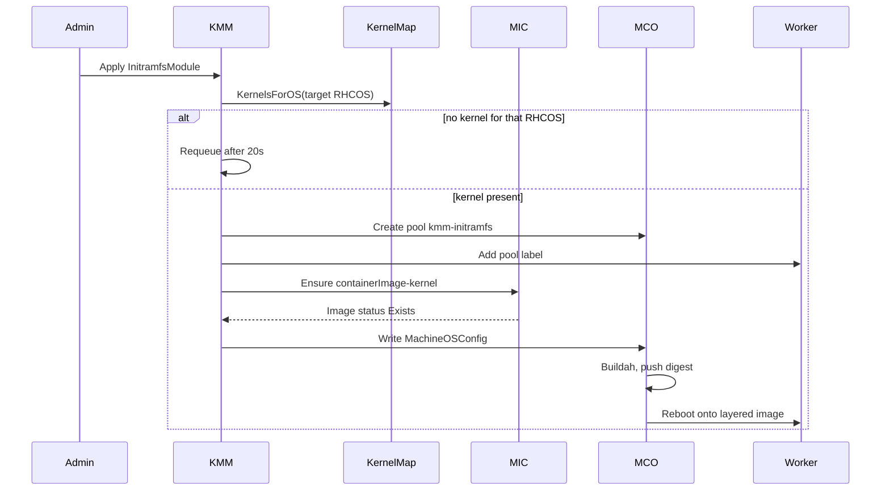
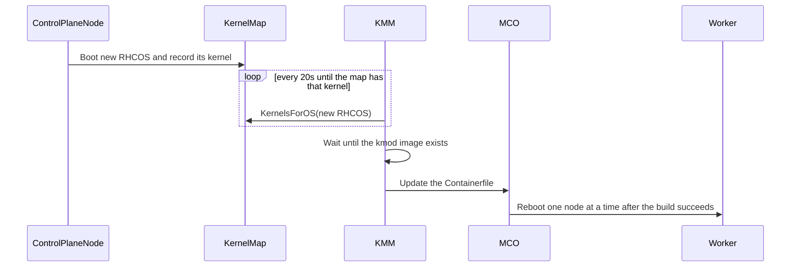

# Initramfs OOT modules through MachineOSConfig

| Field       | Value                                 |
|-------------|---------------------------------------|
| Author(s)   | Yevgeny Shnaidman |
| Jira        | [MGMT-25378](https://issues.redhat.com/browse/MGMT-25378) |
| PRD         | [0006-initramfs-oot-modules.md](0006-initramfs-oot-modules.md) |
| Date        | 2026-11-17 |

# 1. Overview

Selected worker nodes boot an RHCOS initramfs that contains the out-of-tree kernel modules named by an `InitramfsModule`. KMM does not rebuild the initramfs on the node. It asks `ModuleImagesConfig` for a per-kernel kmod image, then writes one `MachineOSConfig` for pool `kmm-initramfs`. The Machine Config Operator builds a layered RHCOS image with Buildah and reboots pool members onto it.

On a cluster upgrade, KMM learns the new kernel only after a control-plane node has booted it and KMM's in-memory kernel map has that entry. Until the layered build for that kernel has succeeded, workers in the pool stay on the previous layered image. This upgrade path is only for a cluster whose control plane is not single-replica. [Locked: D1] [Locked: D4] [Locked: D5]

# 2. Goals and Non-Goals

## 2.1 Goals

- Deliver the initramfs by a `MachineOSConfig` layered image for pool `kmm-initramfs`, with Buildah run by the Machine Config Operator. [User]
- Obtain and sign the kmod image through the existing `ModuleImagesConfig` and `ModuleBuildSignConfig` flow. [PRD: FR-5] [PRD: FR-6]
- Hold the pool on the previous layered image until the Containerfile build for the new kernel has succeeded. [Locked: D1]
- Resolve the target kernel from KMM's in-memory map, requeueing every 20 seconds while the entry for the target RHCOS version is absent. [Locked: D5]
- Leave node reboot, image pull, and pool rollout to the Machine Config Operator.

## 2.2 Non-Goals

- Hub `ManifestWork` distribution, preflight validation, and day-1 `BootModuleConfig`.
- Rebuilding the initramfs on the node with `rpm-ostree initramfs`.
- Cluster upgrade on single-node OpenShift. [Locked: D4]
- On-cluster image mode for multi-architecture compute pools. [Research: Integration Constraints]

# 3. Motivation / Background

Nodes that need an out-of-tree driver for the root filesystem or the network interface cannot wait until after kubelet starts to load it. The initramfs has to contain that driver. The in-progress on-node path runs `rpm-ostree initramfs` from a systemd unit after the node has already booted the new kernel, so a missing kmod image cannot keep the previous kernel in place. [Codebase: docs/enhancements/0007-initramfs-oot-modules-design.md]

`MachineOSConfig` is the supported way to add content to RHCOS and roll a pool onto the result. The Machine Config Operator renders a Dockerfile whose `configs` stage is the pool's current OS plus its MachineConfigs, appends the user Containerfile, and runs Buildah in a Job. A failed build does not replace `status.currentImagePullSpec` from the last success. [Research: On-cluster image mode]

KMM already records `kernelVersion → rhcosVersion → dtkImage` from nodes that are running. It has no OS-to-kernel lookup, and `GetImage` cannot answer for an RHCOS version no node has booted. [Codebase: internal/syncronizedmap/syncronizedmap.go]

# 4. Design

## 4.1 Architecture

The spoke manager registers `InitramfsModuleReconciler`. It is not registered in `cmd/manager/main.go` today. [Codebase: cmd/manager/main.go]

The reconciler watches `InitramfsModule`, nodes, the `openshift/driver-toolkit` ImageStream, the owned `ModuleImagesConfig`, and `MachineOSConfig` `kmm-initramfs`. It does not watch `MachineOSBuild` or `MachineConfigPool`. A failed build leaves `status.currentImagePullSpec` and each node's `machineconfiguration.openshift.io/currentImage` unchanged, so the controller has nothing new to record. It learns that a pool node has booted the layered image when that annotation equals `status.currentImagePullSpec`. [User] `github.com/openshift/api` is updated to a commit that contains `machineconfiguration.openshift.io/v1` `MachineOSConfig`, then vendored. The pin in this tree (`v0.0.0-20240514123321-944467d2cc3b`) does not contain that type. [Codebase: go.mod]



The diagram is the first apply. The pool is created and the selected workers are labeled before `MachineOSConfig` exists. That pool still renders the worker MachineConfigs and the base RHCOS image, which is the image those workers are already running, so the label does not reboot them. KMM writes `MachineOSConfig` only after the kmod image exists. The Machine Config Operator reboots a worker when that build succeeds and the pool's image becomes the layered image. While the map has no kernel, or the kmod image does not exist yet, KMM does not write `MachineOSConfig`. [User]



The upgrade diagram is why the flow needs a control-plane node that is not in `kmm-initramfs`. That node boots stock RHCOS for the new release and fills the map. Workers stay on the previous layered image until the new Containerfile build succeeds. [Locked: D1] [Locked: D4]

### Target kernel

The target RHCOS version is the ImageStream tag, other than `latest`, whose `dockerImageReference` equals the `latest` tag and whose name matches `\d+\.\d+\.\d+-\d`. That pattern is the one `KernelDTKReconciler` already extracts from `node.status.nodeInfo.osImage`. [Codebase: internal/controllers/kernel_dtk_reconciler.go] [Research: Kernel lookup]

`KernelOsDtkMapping` gains `KernelsForOS(osVersion string) []string`, returning every kernel key whose stored OS version equals `osVersion`. Keys stay in today's form: `node.status.nodeInfo.kernelVersion` with one trailing `+` removed.

- No matching tag, or more than one: do not write `MachineOSConfig`. Set condition `Degraded` reason `DriverToolkitTagAmbiguous`. Requeue with the controller-runtime error backoff.
- `KernelsForOS` is empty: set condition `Progressing` reason `KernelUnknown`. Return `RequeueAfter: 20s`. Repeat on every reconcile until the slice is non-empty. This is not a single retry. [Locked: D5]
- One kernel: use it.
- More than one kernel: use the `kernelVersion` of a Ready node labeled `node-role.kubernetes.io/master` or `node-role.kubernetes.io/control-plane` whose OS version equals the target. If those nodes do not all report the same kernel, set `Degraded` reason `AmbiguousKernel` and do not write `MachineOSConfig`.

The kmod image tag must contain the kernel version the image was built for. The image reference is `spec.containerImage + "-" + tagKernel`. `tagKernel` is the selected kernel with every `+` replaced by `-`, because a container tag cannot contain `+`. `quay.example/kmods/ice:built` and kernel `5.14.0-427.13.1.el9_4.x86_64` produce `quay.example/kmods/ice:built-5.14.0-427.13.1.el9_4.x86_64`. That is the suffix `ModuleImagesConfig` already uses. [Codebase: internal/controllers/initramfsmodule_reconciler.go] [User]

The selected kernel is the string the Containerfile compares with the RHCOS `/lib/modules` directory. The controller writes that string into the script when it updates `MachineOSConfig`. It does not read the kernel back from the tag. A realtime kernel `5.14.0-284.25.1.rt14.302.el9_2.x86_64+rt` is tagged `5.14.0-284.25.1.rt14.302.el9_2.x86_64-rt`, and the comparison keeps `+rt` because that is the directory name. The kmod image does not contain a kernel-version file. The controller does not read `/etc/driver-toolkit-release.json` to choose this kernel. [Locked: D4] [User]

### Single-node OpenShift

Read `config.openshift.io/v1` `Infrastructure` `cluster`, field `status.controlPlaneTopology`. When the value is `SingleReplica` and `KernelsForOS` is empty for the target RHCOS version, set `Degraded` reason `SingleNodeUpgrade`, leave `MachineOSConfig` unchanged, and requeue every 20 seconds. Initial apply on single-node OpenShift still proceeds when the map already has the kernel for the RHCOS version that `driver-toolkit:latest` points at, because the node is already running that kernel. [Locked: D4]

### Module image

Create or patch `ModuleImagesConfig` named `irm-<initramfsmodule name>` in the CR namespace, owned by the CR. The image entry uses the suffixed reference above, plus `spec.build`, `spec.sign`, `spec.imageRepoSecret`, and `spec.dirName` when set. Signing uses the existing sign build. The reconciler does not write `MachineOSConfig` until that image's status is `Exists`. A missing image with `spec.build` unset stays `Progressing` reason `ImageNotReady`. The pool and its node labels are already in place. [Codebase: internal/mic/mic.go]

Before writing the Containerfile, the reconciler resolves that image's manifest digest with the pull secret from §4.5. The `FROM` line is pinned to `@sha256:<digest>`. If the digest cannot be resolved, reason `ImageNotReady` and do not write `MachineOSConfig`.

### Pool membership

Ensure `MachineConfigPool` `kmm-initramfs`:

- Annotations `kmm.sigs.x-k8s.io/initramfsmodule-namespace`, `kmm.sigs.x-k8s.io/initramfsmodule-name`, and `kmm.sigs.x-k8s.io/initramfsmodule-uid`. If the pool exists and the namespace or name annotation names a different CR, set `Degraded` reason `PoolConflict` and do not patch the pool or `MachineOSConfig`.
- `spec.maxUnavailable` is `1`.
- `spec.machineConfigSelector` matches label `machineconfiguration.openshift.io/role` in `worker` and `kmm-initramfs`.
- `spec.nodeSelector` is `node-role.kubernetes.io/initramfs=""` when `spec.selector` is empty. Otherwise it is `spec.selector`. [User] [Codebase: internal/mcfg/mcfg.go]

When `spec.selector` is empty, add `node-role.kubernetes.io/initramfs=""` only to nodes that already have `node-role.kubernetes.io/worker=""`, and never to a node that has `node-role.kubernetes.io/master` or `node-role.kubernetes.io/control-plane`. When `spec.selector` is set, do not add that role label. If a selected node has either control-plane label, set `Degraded` reason `ControlPlaneSelected` and do not update the pool selector.

Do not create MachineConfig `99-kmm-initramfs`. If that object exists and carries this CR's stamp, delete it so the pool does not also install the on-node systemd unit.

On every reconcile, including while the kernel is unknown and while the kmod image is not `Exists`, the controller does these steps in order:

1. Create or patch `MachineConfigPool` `kmm-initramfs` as specified above.
2. Label the selected workers so they match `spec.nodeSelector`. For an empty selector, add `node-role.kubernetes.io/initramfs=""`. For a set selector, the nodes already carry `spec.selector`; the controller does not add the role label.
3. After the kmod image status is `Exists`, create or patch `MachineOSConfig`.

Step 2 puts the workers in the pool while the pool's rendered config is still the worker MachineConfigs and the base RHCOS image. The Machine Config Operator does not reboot them for that membership change. The reboot happens when step 3's build succeeds and the pool's OS image changes to the layered image. A failed build leaves `currentImagePullSpec` and the node's `currentImage` on the previous image, so the node stays booted. KMM never creates a reboot pod and never calls the node reboot API. [User]

A second `InitramfsModule` in the cluster is rejected by the validating webhook. The message is `only one InitramfsModule is supported; <namespace>/<name> already exists`. The pool stamp is the backstop if two creates race the webhook.

### MachineOSConfig

`metadata.name` and `spec.machineConfigPool.name` are `kmm-initramfs`. `spec.imageBuilder.imageBuilderType` is `Job`. One `spec.containerFile` entry is written. `containerfileArch` is taken from the selected workers' `status.nodeInfo.architecture`: `amd64` → `AMD64`, `arm64` → `ARM64`, `ppc64le` → `PPC64LE`, `s390x` → `S390X`. If those nodes are not all the same architecture, set `Degraded` reason `MixedArchitecture` and do not write the object. [Research: Integration Constraints]

`spec.renderedImagePushSpec` is:

`image-registry.openshift-image-registry.svc:5000/openshift-machine-config-operator/kmm-initramfs:<tagKernel>-<digest12>`

`<tagKernel>` is the selected kernel with every `+` replaced by `-`. `<digest12>` is the first 12 hex characters of the pinned kmod digest. A new kmod digest changes the push spec, so the Machine Config Operator starts a new build.

`spec.renderedImagePushSecret.name` and `spec.baseImagePullSecret.name` are the secrets in §4.5.

The controller patches `MachineOSConfig` only when the rendered spec differs. An unchanged spec does not start a new build and does not reboot nodes that remain selected. [PRD: FR-18]

If the rendered `content` is longer than 4096 characters, do not patch. Set `Degraded` reason `ContainerfileTooLarge`.

The last stage is `FROM configs AS final`. The kmod image is an earlier stage because the Buildah Job has no local build context. [Research: Final stage] [User]

`dirName` defaults to `/opt` when empty. `firmwarePath` is omitted from the Containerfile when empty.

```dockerfile
FROM <kmod-image>@sha256:<digest> AS kmod
FROM configs AS final
COPY --from=kmod <dirName>/lib/modules/ /tmp/kmm/modules/
COPY --from=kmod <firmwarePath>/ /lib/firmware/updates/<kernel>/
RUN set -eu; \
  kv='<kernel>'; \
  test -n "$kv"; \
  set -- /lib/modules/*/; \
  test "$#" -eq 1; \
  test "$(basename "${1%/}")" = "$kv"; \
  set -- /tmp/kmm/modules/*/; \
  test "$#" -eq 1; \
  src="${1%/}"; \
  find "$src" -type f \( -name '*.ko' -o -name '*.ko.xz' -o -name '*.ko.gz' -o -name '*.ko.zst' \) -print | \
  while read -r f; do \
    rel=${f#"$src"/}; \
    mkdir -p "/lib/modules/$kv/$(dirname "$rel")"; \
    cp -f "$f" "/lib/modules/$kv/$rel"; \
  done; \
  depmod -a "$kv"; \
  printf '%s\n' <moduleNames and addDrivers, one name per line> > /tmp/kmm/names; \
  if [ -f "/lib/modules/$kv/modules.softdep" ]; then \
    awk -v allow='^(<moduleNames joined by |>)$' \
      '$1=="softdep" && $2 ~ allow { for (i=3;i<=NF;i++) if ($i!="pre:" && $i!="post:") print $i }' \
      "/lib/modules/$kv/modules.softdep" >> /tmp/kmm/names; \
  fi; \
  if [ -s /tmp/kmm/omit ]; then grep -v -F -x -f /tmp/kmm/omit /tmp/kmm/names > /tmp/kmm/add || true; \
  else cp /tmp/kmm/names /tmp/kmm/add; fi; \
  { echo "add_drivers+=\" $(sort -u /tmp/kmm/add | tr '\n' ' ')\""; \
    if [ -s /tmp/kmm/omit ]; then echo "omit_drivers+=\" $(tr '\n' ' ' < /tmp/kmm/omit)\""; fi; \
  } > /usr/lib/dracut/dracut.conf.d/99-kmm-initramfs.conf; \
  dracut --force --no-hostonly --kver "$kv"; \
  ostree container commit
```

The controller writes `/tmp/kmm/omit` with `printf '%s\n'` of `spec.omit` only when that list is non-empty. An empty pattern file is not passed to `grep`, because GNU `grep -f` would then treat every name as a match. The firmware `COPY` is emitted only when `spec.firmwarePath` is set. `grep` may exit non-zero when every name was omitted; `|| true` keeps the script on that path.

When `spec.firmwarePath` is set, the kmod image stores each firmware file at `<firmwarePath>/<firmware-string>`. `<firmware-string>` is the module's `firmware` modinfo value. For `firmware: intel/ice/ddp/ice.pkg`, the image contains `<firmwarePath>/intel/ice/ddp/ice.pkg`. The `COPY` places that directory at `/lib/firmware/updates/<kernel>/`, so the file lands at `/lib/firmware/updates/<kernel>/intel/ice/ddp/ice.pkg`. `<kernel>` is the kernel selected above, and the script passes that same version to `dracut --kver`. On RHCOS `/lib` and `/usr/lib` are the same directory. Dracut searches `/lib/firmware/updates/<kernel>` first. The OOT module is one dracut installs, through `add_drivers` or its generic set, so dracut reads the module's `firmware` modinfo and copies each named file into the initramfs at that path. The running kernel opens the same path. [User]

`depmod -a` and `dracut --kver` take the image kernel because the Buildah container's `uname -r` is the kernel of the node running the Job, not the kernel tree in the RHCOS image. `dracut --force --no-hostonly --kver "$kv"` followed by `ostree container commit` is the initramfs the node boots. A node booted that image and loaded the out-of-tree module from the initramfs. The Containerfile ends with `ostree container commit` on OpenShift 4.22 and later. [User]

The controller renders the selected kernel into `kv=` when it writes the Containerfile. `<kernel>` in the firmware `COPY` is that same string. The script fails the build when `/lib/modules` does not contain exactly one directory, or when that directory name differs from `kv`. The kmod image supplies the module files and does not supply this version. Each `.ko` is copied to the same relative path under `/lib/modules/<kernel>/`. `add_drivers` contains `spec.moduleNames`, `spec.addDrivers`, and the `pre:` / `post:` names from `modules.softdep` lines for those `moduleNames`. Names in `spec.omit` are removed from `add_drivers` and written to `omit_drivers`. Dracut's `instmods` then installs hard dependencies from `modules.dep` for every `add_drivers` name. Soft dependencies are the names the script added. The operator does not list either set. [PRD: FR-10] [Research: dracut inclusion]

`add_drivers` is used so a module outside dracut's generic directory set is still installed. `force_drivers` is not written. `force_drivers` also loads the module in the pre-udev hook, which can bind a device before udev when a second driver matches it. [Research: force_drivers]

The same name in `add_drivers` and `omit_drivers` is dropped from `omit_drivers` by dracut. The webhook rejects a CR where `spec.omit` intersects `spec.moduleNames` or `spec.addDrivers`, with message `omit contains a name that is also installed: <name>`.

### Status and the scheduling label

`status.conditions` uses `metav1.Condition`:

| Type | True when |
|------|-----------|
| `Progressing` | The target kernel is unknown, the kmod image is not `Exists`, the live `MachineOSConfig` spec is not the rendered spec, or a selected node is in the pool and its `currentImage` is not `currentImagePullSpec` |
| `Degraded` | A reason in §4.6 is set |

`status.successfulImagePullSpecs` appends `MachineOSConfig.status.currentImagePullSpec` whenever that field is non-empty and not already listed. Old digests stay for the life of the CR.

`status.nodes[]` has one entry per node that matches the selector. The state enum stays `Pending`, `Created`, `Applied`, and `Failed`.

| State | Rule |
|-------|------|
| `Pending` | The node is not in the pool, or `successfulImagePullSpecs` is empty. Reason `KernelUnknown` or `ImageNotReady` |
| `Created` | The node is in the pool and `machineconfiguration.openshift.io/currentImage` is empty or is not the latest `currentImagePullSpec` |
| `Applied` | The node is in the pool and `currentImage` equals the latest `currentImagePullSpec` |
| `Failed` | Not set. A failed Containerfile build does not change `currentImagePullSpec` or the node's `currentImage`, and the controller does not read `MachineOSBuild` |

A node whose `currentImage` equals `currentImagePullSpec` stays `Applied` when a later build fails. [User]

When `currentImage` is one of `successfulImagePullSpecs`, set label `kmm.node.kubernetes.io/initramfs.<namespace>.<name>=""`. Remove that label when the node no longer matches the selector and when the CR is deleted. A newer successful build does not remove the label from a node that is still booted on an older successful digest. [PRD: FR-17]

`kernelVersion` on the node status is `node.status.nodeInfo.kernelVersion`.

### Delete and deselect

The CR finalizer is `kmm.sigs.x-k8s.io/initramfsmodule`.

Deselect removes `node-role.kubernetes.io/initramfs` when this controller added it, and removes the scheduling label. `MachineOSConfig` stays. The Machine Config Operator returns the node to its other pool and reboots it onto that pool's image. [Locked: D2]

Delete removes the scheduling label and the initramfs role label, deletes `MachineOSConfig` `kmm-initramfs`, deletes pool `kmm-initramfs`, then removes the finalizer. Deleting `MachineOSConfig` returns members to the cluster's current base RHCOS image. Removing the role label returns them to the worker pool. [Locked: D3] [Research: What delete and deselect do]

`spec.rollback` is not read. The webhook rejects `rollback: true` with message `rollback is invalid; remove the node from the selector or delete the InitramfsModule`.

## 4.2 Data Model / Schema Changes

No database schema. The stored objects are Kubernetes resources.

`InitramfsModule` stays namespaced, short name `irm`, group `kmm.sigs.x-k8s.io/v1beta1`. Existing fields keep their current validation. [Codebase: api/v1beta1/initramfsmodule_types.go]

New field:

```go
// AddDrivers are extra dracut add_drivers names, without .ko.
// +optional
// +listType=set
// +kubebuilder:validation:items:Pattern=`^[A-Za-z0-9_-]+$`
AddDrivers []string `json:"addDrivers,omitempty"`
```

`spec.dirName` and `spec.firmwarePath`, when set, must match `^/[A-Za-z0-9._/-]+$` and must not contain `..`. The webhook enforces that. Empty `dirName` means `/opt`. `spec.firmwarePath` is the root, inside the kmod image, of the relative paths named by the module's `firmware` modinfo.

Status additions:

```go
SuccessfulImagePullSpecs []string `json:"successfulImagePullSpecs,omitempty"`
Conditions []metav1.Condition `json:"conditions,omitempty"`
```

`status.nodes[]` is unchanged: `name`, `kernelVersion`, `state` (`Pending`, `Created`, `Applied`, `Failed`), `reason`.

`KernelOsDtkMapping` is in-memory. `KernelsForOS` is a new method on that interface. It is not a CRD field.

## 4.3 API Changes

The operator-facing API is the CR above, plus the cluster objects KMM writes. There is no new HTTP endpoint and no change to `Module`.

Example:

```yaml
apiVersion: kmm.sigs.x-k8s.io/v1beta1
kind: InitramfsModule
metadata:
  name: nic
  namespace: kmm-test
spec:
  moduleNames:
    - ice_enh
  omit:
    - ice
  addDrivers:
    - crc32c
  containerImage: quay.example/kmods/ice:built
  firmwarePath: /firmware
  dirName: /opt
  imageRepoSecret:
    name: ice-pull
```

For kernel `5.14.0-427.13.1.el9_4.x86_64`, the `ModuleImagesConfig` image is `quay.example/kmods/ice:built-5.14.0-427.13.1.el9_4.x86_64`. The rendered `MachineOSConfig` push spec ends in `kmm-initramfs:5.14.0-427.13.1.el9_4.x86_64-<digest12>`. With modinfo `firmware: intel/ice/ddp/ice.pkg`, the kmod image contains `/firmware/intel/ice/ddp/ice.pkg` and the Containerfile copies `/firmware/` to `/lib/firmware/updates/5.14.0-427.13.1.el9_4.x86_64/`.

Validation:

- `moduleNames` has at least one entry. Each of `moduleNames`, `omit`, and `addDrivers` matches `^[A-Za-z0-9_-]+$`.
- `omit` must not intersect `moduleNames` or `addDrivers`.
- `rollback: true` is rejected.
- A second `InitramfsModule` in any namespace is rejected.
- `containerImage` is required and non-empty.

Create, update, and delete work with `oc` and the OpenShift console because the CRD is installed by the operator bundle. No console plugin is added. A `Module` object is not required.

`MachineOSConfig` and `MachineConfigPool` are cluster-scoped objects an admin can `oc get`. They are not a supported way to hand-author this feature. KMM owns the spec it writes.

## 4.4 Scalability and Performance

One cluster has one `InitramfsModule`, one pool, and one Buildah Job at a time. The Job runs in `openshift-machine-config-operator` and is the CPU cost that matters. The pool updates one node at a time.

The controller's 20 second requeue runs only while `KernelsForOS` is empty or the cluster is single-replica and waiting on that empty result. After the kernel is known, reconcile is driven by watches.

The in-memory map is the map KMM already keeps. No extra etcd object is written per node beyond the existing node label and the CR status entry.

Each successful kernel pushes one tag under `openshift-machine-config-operator/kmm-initramfs`. This design does not delete older tags. Registry pruning stays with the cluster image pruner.

## 4.5 Security Considerations

`spec.baseImagePullSecret` authenticates every pull in the Containerfile, including `FROM` and `COPY --from` of the kmod image. The controller builds that secret as `kmm-initramfs-pull`, type `kubernetes.io/dockerconfigjson`, in `openshift-machine-config-operator`. It is the cluster pull secret `openshift-config/pull-secret` unified with one kmod credential. When `spec.imageRepoSecret` is set, that credential is the named secret in the `InitramfsModule` namespace. When `spec.imageRepoSecret` is empty, the kmod image is in the internal registry, and the credential is the `builder-dockercfg-<hash>` secret of the `builder` ServiceAccount in the `InitramfsModule` namespace. Merge `.auths`: keys from the kmod credential replace the same keys from the cluster pull secret. `spec.baseImagePullSecret.name` is `kmm-initramfs-pull`. [User]

`spec.renderedImagePushSecret.name` is the `builder-dockercfg-<hash>` secret on the `builder` ServiceAccount in `openshift-machine-config-operator`. That ServiceAccount still has this secret. KMM does not create a push token. If the secret is absent, set `Degraded` reason `PushSecretMissing` and do not write `MachineOSConfig`. If either input to the pull merge is absent, reason `PullSecretMissing`. [User]

The reconciler must not log secret data.

Workers pull the layered image with the existing `machine-os-puller` ServiceAccount. They do not use the push secret. [Research: Node pull] [User]

`moduleNames`, `omit`, and `addDrivers` are restricted to the CRD pattern before they are written into the shell script. `dirName` and `firmwarePath` must be absolute paths without `..`. The image reference in `FROM` is the digest the controller resolved, not a shell expansion of `spec.containerImage`.

Any subject who can create `InitramfsModule` can move worker nodes into this pool. That is the same cluster-wide effect as creating a `Module` that loads a kernel module on selected nodes. The new privilege is read of the cluster pull secret and write of one docker config secret in the Machine Config Operator namespace.

## 4.6 Failure Handling and Recovery

| Condition | KMM action | What the node does |
|-----------|------------|--------------------|
| Kernel not in the map | `Progressing` `KernelUnknown`, requeue 20s, do not patch `MachineOSConfig` | Stays on its current boot. On upgrade that boot is the previous layered image |
| Single-replica control plane and kernel missing | `Degraded` `SingleNodeUpgrade`, requeue 20s, do not patch `MachineOSConfig` | Stays on the previous layered image |
| Kmod image not `Exists` | `Progressing` `ImageNotReady`. The pool and node labels stay. Do not patch `MachineOSConfig` | Stays on its current boot. The pool still renders the base image. [PRD: FR-14] [PRD: NFR-1] |
| Containerfile build fails, including a kernel mismatch or a missing firmware path | No condition. The controller does not read `MachineOSBuild` | `currentImagePullSpec` stays on the previous digest, and each pool node's `currentImage` stays there, so the node stays `Applied`. [Locked: D1] [User] |
| `content` longer than 4096 characters | `Degraded` `ContainerfileTooLarge`, do not patch | Stays on the current image |
| Push or pull secret missing | `Degraded` `PushSecretMissing` or `PullSecretMissing`, do not patch | Stays on the current image |
| Pool or name stamp owned by another CR | `Degraded` `PoolConflict`, do not patch | No membership change |
| Selected node is a control-plane node | `Degraded` `ControlPlaneSelected`, do not update the pool selector | Control-plane nodes are not moved into the pool |
| Mixed worker architecture | `Degraded` `MixedArchitecture`, do not write `MachineOSConfig` | No membership change |
| Deselect | Remove the role label this controller added, and the scheduling label | The Machine Config Operator reboots the node onto the primary pool's image. [Locked: D2] |
| Delete | Delete `MachineOSConfig` and the pool, remove labels | Nodes return to the worker pool's current base RHCOS. [Locked: D3] |

The Machine Config Operator retries a failed Job three more times. KMM does not start a second builder and does not reconcile when that Job fails.

A machine-set node that joins the pool can boot the base image once and then reboot onto the layered image, because it cannot pull the internal registry until it has joined. The scheduling label is set only after `currentImage` is one of `successfulImagePullSpecs`. [Research: New nodes] [PRD: FR-11]

Requeue of 20 seconds is only for an empty `KernelsForOS` result, including the single-replica case. Other failures return an error and use the controller-runtime backoff. Patching the same spec again is a no-op.

On OpenShift 4.22 and later, a failed or unfinished `MachineOSBuild` leaves pool members on the previous layered image. The feature targets those versions. The controller's own hold is: nodes are already in the pool, and the controller does not point the Containerfile at a kmod image that is not `Exists`. The pool's OS image changes only after a successful build. [User]

## 4.7 RBAC / Tenancy

`InitramfsModule` stays namespaced. One CR may exist in the cluster. The manager ClusterRole gains:

- `initramfsmodules` and `/status`: existing verbs, plus update of `conditions`
- `machineosconfigs`: get, list, watch, create, update, patch, delete. No `machineosbuilds` rule. The controller does not read that object. [User]
- `secrets`: get, list, watch cluster-wide; create, update, patch on `kmm-initramfs-pull` in `openshift-machine-config-operator`
- `imagestreams`: get, list, watch in `openshift` for `driver-toolkit`
- `infrastructures` (`config.openshift.io`): get `cluster`

Existing rules for `ModuleImagesConfig`, `ModuleBuildSignConfig`, builds, `MachineConfig`, `MachineConfigPool`, nodes, and serviceaccounts stay. The webhook ClusterRole gains cluster-wide list on `initramfsmodules` for the single-object check.

No new tenant boundary. The operator process can read the cluster pull secret. That secret is merged into the Machine Config Operator namespace and is not copied onto nodes by KMM.

## 4.8 Extensibility / Future-Proofing

`spec.build` and `spec.sign` are the shared `Module` types, so a new build argument applies here without a second API. `moduleNames`, `omit`, and `addDrivers` are lists. `KernelsForOS` is the lookup this flow needs; callers of `GetImage` stay as they are. A hub wrapper would be a new API and is outside this design. Changing early-boot load behavior would mean writing `force_drivers` in the Containerfile; this design does not add a field for that.

# 5. Interface Changes

## IC-1: InitramfsModule create, update, and delete

**Requirements:** FR-1, FR-2

Namespaced CR `InitramfsModule` (`irm`) in `kmm.sigs.x-k8s.io/v1beta1`. Create, update, and delete with `oc` and the OpenShift console. No `Module` is required. The webhook rejects a second object. See §4.3.

## IC-2: InitramfsModule spec

**Requirements:** FR-3, FR-4, FR-5, FR-6, FR-7, FR-8, FR-9, NFR-2

Fields in §4.2 and §4.3. Empty `selector` targets workers and labels them `node-role.kubernetes.io/initramfs`. A set selector is the pool node selector. `containerImage` is `<repository>:<partialTag>`. The kmod image tag must be that partial tag, then `-`, then the kernel the image was built for, with every `+` in the kernel replaced by `-`. The image does not contain a kernel-version file. `build` and `sign` use `ModuleImagesConfig` and `ModuleBuildSignConfig`. `firmwarePath` is the kmod-image directory copied to `/lib/firmware/updates/<kernel>/`. `addDrivers` and `omit` are dracut name lists. `rollback: true` is rejected.

## IC-3: InitramfsModule status

**Requirements:** FR-16, NFR-3

`status.nodes[]` states `Pending`, `Created`, `Applied`, `Failed`, plus `status.conditions` and `status.successfulImagePullSpecs`. Visible with `oc get initramfsmodule -o yaml` and in the console. See §4.1.

## IC-4: Scheduling label

**Requirements:** FR-17

Label `kmm.node.kubernetes.io/initramfs.<namespace>.<name>=""` when the node's `machineconfiguration.openshift.io/currentImage` is in `status.successfulImagePullSpecs`. Removed on deselect and delete.

## IC-5: MachineConfigPool kmm-initramfs

**Requirements:** FR-3, FR-11, FR-18, FR-19, FR-21

Pool `kmm-initramfs`, `maxUnavailable: 1`, worker MachineConfigs selected, node selector as in §4.1. The pool is created and the selected nodes are labeled before `MachineOSConfig` exists. Joining that pool does not reboot them while its rendered config is still the worker configuration and the base RHCOS image. An unchanged `MachineOSConfig` spec does not reboot selected nodes. A successful layered build rolls current members one node at a time. KMM does not call reboot. Nodes outside the selector are not rolled for that change.

## IC-6: MachineOSConfig kmm-initramfs

**Requirements:** FR-7, FR-8, FR-9, FR-10, FR-12, FR-13, FR-14, FR-21, NFR-1

`MachineOSConfig` `kmm-initramfs` with the Containerfile in §4.1. The object is not created or updated until the kmod image exists. A missing kernel or a missing image leaves existing members on the previous layered image. A failed build does the same, and the controller does not report that failure. `oc get machineosconfig kmm-initramfs` shows `status.currentImagePullSpec`. The node annotation `machineconfiguration.openshift.io/currentImage` shows whether a pool node has booted it.

## IC-7: Deselect

**Requirements:** FR-20

Removing a node from the selector removes the pool role label, when KMM added it, and the scheduling label. The Machine Config Operator reboots that node onto the primary pool's image. `MachineOSConfig` is not deleted.

## IC-8: Delete returns the pool to base RHCOS

**Requirements:** FR-15

Deleting the CR deletes `MachineOSConfig` and pool `kmm-initramfs` and removes both labels. Nodes return to the worker pool and boot that pool's current base RHCOS.

# 6. Alternatives Considered

**On-node `rpm-ostree initramfs`.** The node rebuilds initramfs after it has booted the new kernel. That cannot hold the previous kernel until the kmod image exists. Rejected. [Locked: D1] [Research: Comparison Matrix]

**Out-of-cluster `osImageURL`.** The admin builds the image. OpenShift then stops updating that pool on its own. Rejected. On-cluster `MachineOSConfig` rebuilds the layered image when the pool's MachineConfigs change, and a failed build leaves the last successful digest in status. [Research: Comparison Matrix]

**Read `KERNEL_VERSION` from `driver-toolkit:latest` before any node boots.** The driver-toolkit image contains that JSON, and the in-memory map cannot answer until some node is running the kernel. Rejected for the controller's lookup. The upgrade path waits until a control-plane node boots the new kernel and the map has the entry, and it requeues every 20 seconds until then. The Containerfile compares the RHCOS `/lib/modules` directory with the selected kernel rendered into the script. The kmod image tag carries that kernel, with every `+` replaced by `-`, and the image does not contain a kernel-version file. [Locked: D4] [Locked: D5] [Research: Recommended Approach] [User]

**Inspect Job parses `modules.dep` and `modules.softdep`.** That Job exists for the on-node design and is not called by the reconciler. Rejected here. The Containerfile runs `depmod` on the assembled tree and reads `modules.softdep` in the same `RUN`. Dracut installs hard dependencies of `add_drivers` from `modules.dep`. [Codebase: internal/pod/inspectjob.go]

**`force_drivers` for every OOT name.** Installing a name that dracut already selected does not duplicate the file. It also writes `rd.driver.pre`, and the pre-udev hook `modprobe`s that name before udev. A driver that registers with the PCI or USB bus can then bind a device before another matching driver is loaded. A driver that probes only inside its init function can miss a device that appears later. Rejected. `add_drivers` installs the module and leaves load time to udev. [Research: force_drivers]

**One pool per `InitramfsModule`.** `MachineOSConfig` allows one object per pool, and the name must equal the pool name. The flow names a single pool, `kmm-initramfs`. A second CR cannot target a different selector with that object. Rejected. The webhook rejects the second CR.

**Wait to label workers until `currentImagePullSpec` is set.** Rejected. The pool is created and the nodes are labeled first, and `MachineOSConfig` is created after the kmod image exists. While `MachineOSConfig` is absent, the pool renders the same worker configuration and base RHCOS image the node is already running, so membership does not reboot it. The reboot is the successful layered build. A run of this sequence rebooted the worker only after that build succeeded. [User]

**Remove only `MachineOSConfig` on delete, or only the pool label.** Either step moves nodes toward the current base image, and the two results differ if the custom pool is still selected. Delete does both: remove the label and delete `MachineOSConfig` and the pool. [Research: What delete and deselect do]

# 7. Observability and Monitoring

No new metrics, alerts, or traces.

Operators see `status.conditions`, `status.nodes`, and `status.successfulImagePullSpecs` on the CR. `status.nodes[].state` is `Applied` when that node's `currentImage` equals `MachineOSConfig.status.currentImagePullSpec`. Build failure stays on `MachineOSBuild` and on the pool condition `ImageBuildDegraded`; this controller does not copy it. Controller logs include the target RHCOS version, the chosen kernel, and the requeue reason. They do not include registry credentials.

# 8. Impact and Compatibility

The CRD change is additive (`addDrivers`, status conditions, `successfulImagePullSpecs`) except that `rollback: true` becomes invalid. The on-node reconciler is not registered in `cmd/manager/main.go`, so a running cluster is not yet applying `99-kmm-initramfs`. Registering this design replaces that path: the stamped MachineConfig is deleted if present.

The feature requires OpenShift 4.22 or later, with `MachineOSConfig` v1. On those versions a failed or unfinished build leaves pool members on the previous layered image, and the Containerfile ends with `ostree container commit`. The vendored OpenShift API must be bumped to include that type. Multi-architecture compute pools are unsupported. Single-node OpenShift can apply the current kernel and cannot take this upgrade path. [User]

Workers gain a pool label and a scheduling label. Leaving the selector reboots the node onto the primary pool's image. Deleting the CR reboots pool members onto the worker pool's current base RHCOS.

---

## Provenance

Authored: draft @ design 0.12.0 - 7b2b8de, workspace main @ 8a1f531b (dirty)

<!-- ai-workflow-provenance:{"schema_version":1,"provenance_kind":"session","workflow":"design","workflow_version":"0.12.0","ai_workflows":"7b2b8de","source_repo":"8a1f531b (dirty)","source_repo_branch":"main","commits_behind_main":0,"commits_ahead_main":25,"main_ref":"main","phases":["draft"],"authoring_modes":["skill"],"context_changed":false,"origin_untracked":false} -->
